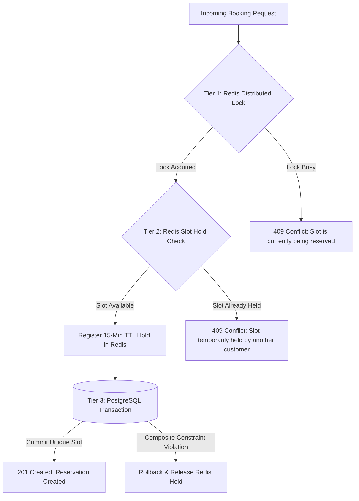
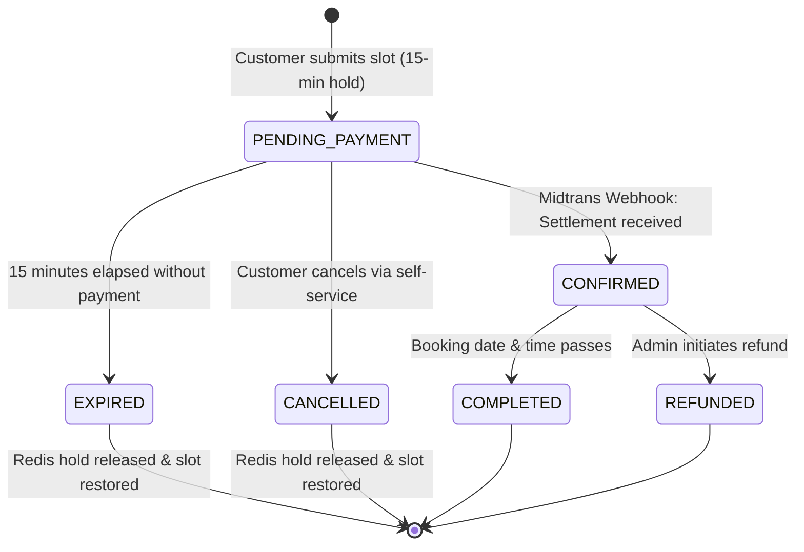

In sports venue booking platforms, high-demand slots (such as weekday evenings 18:00–21:00) frequently encounter concurrent booking attempts. If two customers click "Pay" at the exact same second, naive systems permit duplicate reservations for the same court.

Gajah Berlian Sports Hall implements a **three-tier concurrency defense system** to guarantee mathematical slot exclusivity.

---

## 1. The Three-Tier Defense System



### Tier 1: Distributed Mutex (Redis Redlock Pattern)
* **Component**: `ILockManager` implemented by `RedisLockManager`.
* **Mechanism**: Before evaluating slot availability for court `C` on date `D` at hour `H`, the system acquires a short-lived distributed mutex key in Redis:
  ```
  lock:court:<courtId>:<date>:<hour>
  ```
* **TTL**: 5 seconds auto-release safety timeout.
* **Benefit**: Serializes overlapping concurrent requests for the exact same court hour down to milliseconds, preventing race conditions during read-modify-write cycles.

### Tier 2: 15-Minute Slot Hold Manager
* **Component**: `ISlotHoldManager` implemented by `RedisSlotHoldManager`.
* **Mechanism**: When a customer confirms their slot selection, a hold record is stored in Redis:
  ```
  hold:court:<courtId>:<date>:<hour> -> bookingId
  ```
* **TTL**: 15 minutes (900 seconds).
* **Benefit**: Temporarily reserves the slot while the customer completes payment through Midtrans without prematurely writing a permanent confirmed state to the database. Other customers immediately see this slot as unavailable in availability checks.

### Tier 3: PostgreSQL Database Unique Constraints
* **Component**: Prisma schema database index.
* **Mechanism**: If Redis were ever restarted or suffered network partition, the database schema enforces hard relational integrity at the ACID transaction level:
  ```prisma
  model Booking {
    // ...
    courtId     String
    bookingDate DateTime @db.Date
    startHour   Int

    @@index([courtId, bookingDate])
  }
  ```
  Transactions are isolated, and overlapping active bookings cannot coexist in a confirmed state.

---

## 2. Reservation Lifecycle & Expiration



---

## 3. Background Expiration Scheduler

Even if a user closes their browser or loses internet connection while on the payment screen, the slot must not stay blocked indefinitely.

The backend runs a scheduled cron job using `@nestjs/schedule`:

```typescript
// BE-Gajah-Berlian-Sport-Hall/src/infrastructure/scheduler/BookingExpirationScheduler.ts
@Injectable()
export class BookingExpirationScheduler {
  @Cron(CronExpression.EVERY_MINUTE)
  async handleExpiredBookings() {
    const now = new Date();
    const expiredBookings = await this.bookingRepository.findExpiredPending(now);

    for (const booking of expiredBookings) {
      booking.markAsExpired();
      await this.bookingRepository.save(booking);
      await this.slotHoldManager.releaseHold(booking.courtId, booking.date, booking.startHour);
    }
  }
}
```

* **Interval**: Runs automatically every 60 seconds.
* **Action**:
  1. Queries all bookings with status `PENDING_PAYMENT` where `expiresAt < now`.
  2. Updates booking status to `EXPIRED`.
  3. Releases all corresponding hourly keys in Redis.
  4. Slot instantly returns to green/available status for other players.
