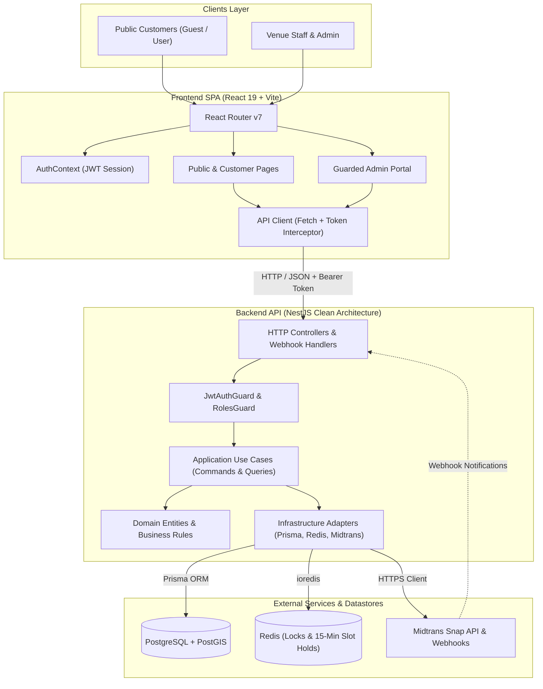
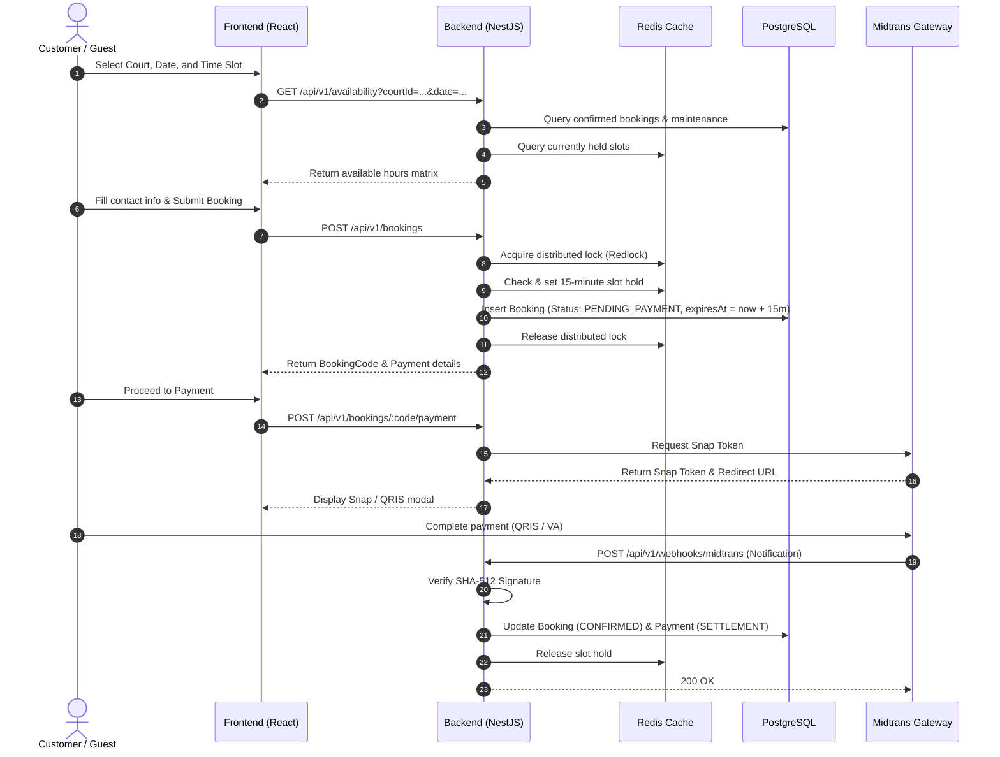

This document outlines the system architecture of the Gajah Berlian Sports Hall booking platform, including subsystem boundaries, the Clean/Hexagonal Architecture in the backend, and data flow patterns.

---

## 1. High-Level System Architecture



---

## 2. Hexagonal / Clean Architecture (Backend)

The backend follows Uncle Bob's **Clean Architecture (Ports & Adapters)** to decouple business logic from external frameworks, database drivers, and third-party vendors.

```
BE-Gajah-Berlian-Sport-Hall/src/
├── core/
│   ├── domain/                  # Enterprise Business Rules (Layer 1)
│   │   ├── booking/             # Booking entity, BookingCode, BookingDuration, Price
│   │   ├── court/               # Court, Venue, OperationalHours
│   │   ├── user/                # User entity, Email, Role
│   │   ├── payment/             # Payment entity, PaymentMethod, PaymentStatus
│   │   └── common/              # DomainException
│   │
│   └── application/             # Application Business Rules (Layer 2)
│       ├── booking/             # CreateBookingReservationUseCase, CancelBookingUseCase...
│       ├── availability/        # CheckAvailabilityQuery, GetCourtsQuery
│       ├── admin/               # GetAdminDashboardStatsQuery, CreateMaintenanceBlockUseCase
│       ├── auth/                # LoginUseCase, RegisterUseCase, GetCurrentUserQuery
│       └── ports/               # ITokenService, IPasswordHasher, ILockManager...
│
├── infrastructure/              # Interface Adapters & Frameworks (Layer 3)
│   ├── database/prisma/         # Prisma repositories implementing domain ports
│   ├── cache/redis/             # RedisLockManager, RedisSlotHoldManager
│   ├── payment/midtrans/        # MidtransPaymentGateway
│   ├── auth/                    # BcryptPasswordHasher, JwtTokenService
│   └── scheduler/               # BookingExpirationScheduler (@nestjs/schedule)
│
└── presentation/                # Driving Adapters (Layer 4)
    ├── http/
    │   ├── controllers/         # AuthController, BookingController, AdminController...
    │   ├── guards/              # JwtAuthGuard, RolesGuard, OptionalJwtAuthGuard
    │   └── dtos/                # Class-validator request & response DTOs
    └── webhooks/
        └── midtrans-webhook.controller.ts # Cryptographic signature validation & processing
```

### Dependency Rule
Dependencies only point **inward**:
- The **Domain** has ZERO external dependencies (no NestJS, no Prisma, no Redis).
- The **Application** layer depends only on Domain entities and abstract ports (interfaces).
- **Infrastructure** implements application ports using concrete technologies (Prisma, Redis, Midtrans).
- **Presentation** drives the application through HTTP requests and DTOs.

---

## 3. End-to-End Booking Sequence


